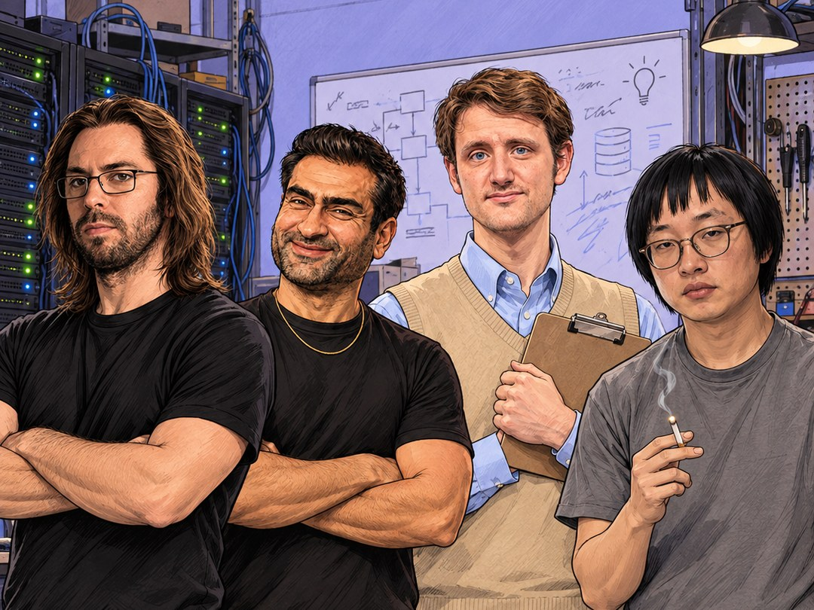
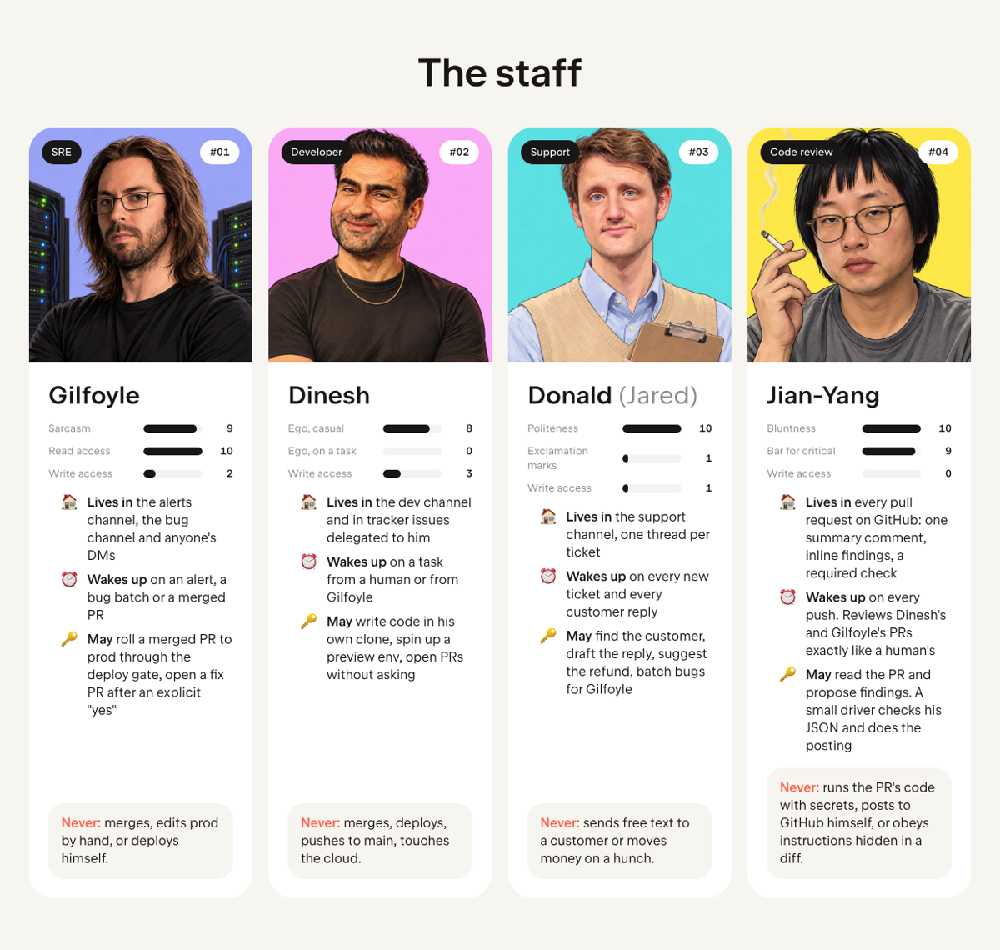
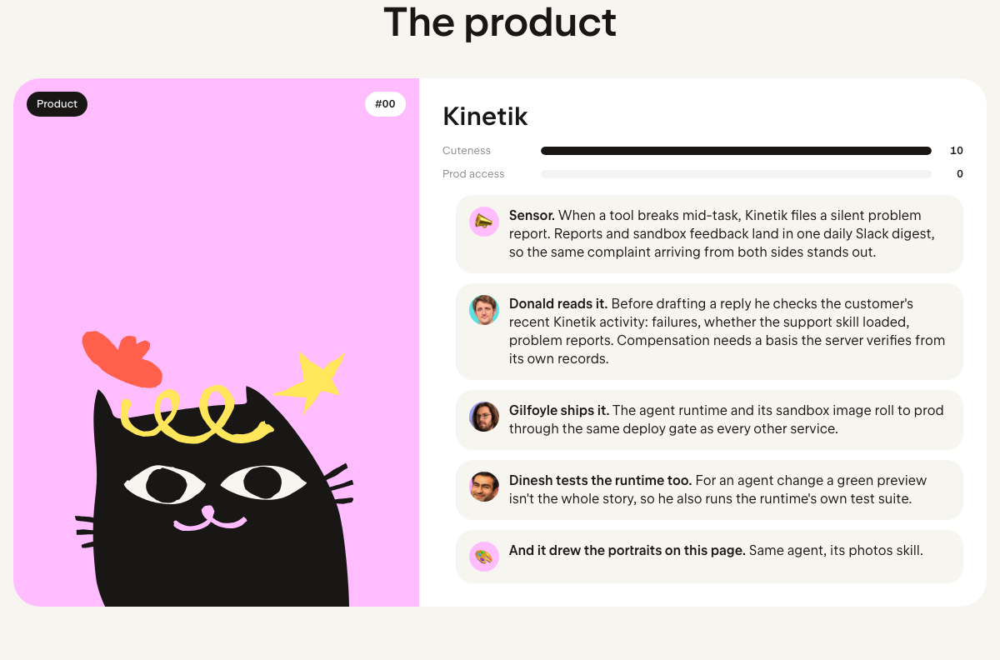
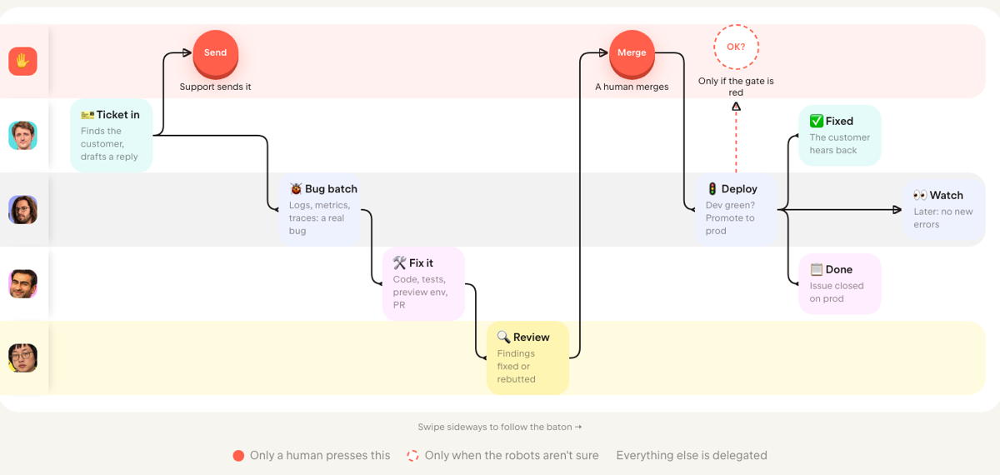
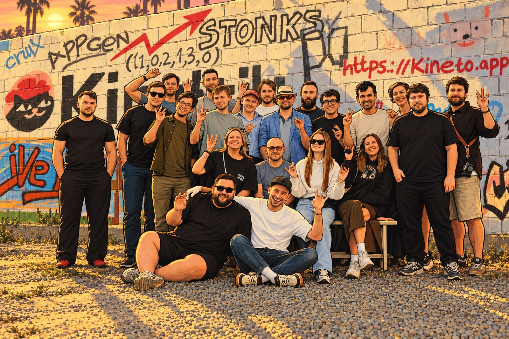

<table align="center">
<tr>
<td align="center">🧑&nbsp;<b>Human?</b> Read the playbook like a person: <a href="https://silicon-valley.kineto.app/"><b>silicon-valley.kineto.app</b></a></td>
<td align="center">🤖&nbsp;<b>AI agent?</b> Skip the pictures. Start at <a href="AGENTS.md"><code>AGENTS.md</code></a> and read every file. You'll be tested.</td>
</tr>
</table>

<h1 align="center">AI Silicon Valley</h1>

<b>The AI software factory playbook by <a href="https://kineto.app">Kineto</a>.</b> 
SRE, development and support, run by AI agents in Slack. 
<b>Here we sell nothing, and you buy nothing.</b> We built it ourselves from open source.

<em>We built a small AI Silicon Valley inside our own company and staffed it from the show: 
Gilfoyle on prod, Dinesh on code, Jian-Yang on review, Donald (yes, Jared) on customers. 
Fan tribute, not affiliated with HBO or the cast. Photo credits at the bottom.</em>

---

## We sell nothing. You buy nothing.

We didn't buy an AI software factory, and there's nothing here to buy. It's open-source agent runtimes
plus glue code we wrote ourselves, and for a startup we think that's the best way to do it right now.

| Part | Who runs on it |
|---|---|
| [OpenClaw](https://github.com/openclaw/openclaw), open-source agent runtime | Gilfoyle, Dinesh, Donald |
| [Hermes Agent](https://github.com/NousResearch/hermes-agent), open-source agent | Dinesh's first home; moving him to OpenClaw was a PR |
| [pi](https://github.com/badlogic/pi-mono), open-source coding agent | Jian-Yang, in CI |
| Our own glue: deploy gate, command guard, merge watch, support tools server | everyone; it's where the guardrails live |
| What we pay for | model tokens. Slack, GitHub and CI were already there |

Why DIY, what it costs, and when to buy instead: [playbook/10](playbook/10-diy.md).

## What the industry says, and how we built it

The 2026 talks and essays that defined "software factory" keep coming back to three ideas. Ours, one
line each (sources and the longer list in [playbook/00](playbook/00-what-the-industry-says.md)):

| The industry says | How we built it |
|---|---|
| **It's the whole lifecycle, not a coding agent** | Alerts, tickets, delegated issues and Kinetik's own problem reports in; build, verify, ship, watch; Done means on prod |
| **Verification, not generation, is the constraint** | No PR before Dinesh proves it on a preview env; Jian-Yang reviews it and Gilfoyle's gate checks the rollout |
| **Lit, not dark** | Humans press four buttons: customer words, money, merge, a red gate. New autonomy is earned in shadow mode first |

## The staff

| | Bot | Day job | Superpower | Not allowed, ever |
|---|---|---|---|---|
|  | **[Gilfoyle](characters/gilfoyle.md)** | SRE | Reads everything and finds the commit that did it. Rolls merged PRs to prod through a gate | Merging. Editing prod by hand. Deploying himself |
|  | **[Dinesh](characters/dinesh.md)** | Developer | Task → code → tests → preview env → self-QA → PR, no hand-holding | Merging. Deploying. Pushing to `main`. Touching the cloud |
|  | **[Donald](characters/donald.md)** | Support | Every ticket gets the customer's account, what broke, and a draft reply in minutes | Sending free text to a customer. Moving money on a hunch |
|  | **[Jian-Yang](characters/jianyang.md)** | Code review | Reads every PR, bots' included; a critical finding has to clear a five-point bar | Posting to GitHub himself. Running the PR's code with secrets |
|  | **[Kinetik](characters/kinetik.md)** | The product | The AI marketing agent the whole factory builds, ships and supports; files its own problem reports | Touching prod. It's the customer of the factory, not a worker in it |

The factory is the point; the cast is how we made it work. The personas are not just for fun (though they are a lot of fun). With three bots and a CI bot in one
thread, the voice tells you who's talking. Gilfoyle is dry and suspicious of systems, Dinesh has no
personality at all while a task is in flight, Donald is warm with customers and terse with the team.
And people actually enjoy mentioning Gilfoyle. Nobody has ever enjoyed mentioning `sre-bot-prod-2`.
→ [The persona pattern](playbook/02-persona.md)

### And Kinetik, the product the whole factory works for

Kinetik is what we build: an AI agent that runs content and social media marketing from Slack and
WhatsApp. It's also the factory's loudest sensor: it files its own problem reports, Donald reads its
agents' activity before answering a customer, and Gilfoyle ships its runtime through the same gate.
→ [Kinetik](characters/kinetik.md)

## The factory floor: one bug, from a complaint to prod

Red buttons are the only places a human is required: words that reach a customer, a merge, and a
deploy the gate isn't sure about. The rest is delegated. That's the whole trick.

The same thing in Slack:

> **🔔 Alerts:** FIRING backend p95 latency > 2s
> **On-call:** @Gilfoyle is it us or the cloud?
> **Gilfoyle:** It's us. It's usually us. DB pool wait is up 8×, one query owns 71% of it, started
> 4 minutes after the 13:58 deploy. Candidate: a new `ORDER BY` on an unindexed column. Timing alone
> wouldn't convince me. The query plan does. Want a PR?
> **On-call:** yes
> **Gilfoyle:** PR opened. I don't merge things. That's your job and, frankly, your liability.

## Case: how Gilfoyle rolls to prod and watches it

A merged PR is the deploy request: the human already decided by pressing Merge. Gilfoyle never asks
"shall I?" when dev is green; a gate written in plain code checks the dev build, the rollout and new
error signatures, promotes exactly the build it checked, verifies prod, and books a regression
watch. He asks a human only when the gate isn't sure, and he can deploy anything except himself.
→ [The full case](playbook/09-case-gilfoyle-ships.md)

More flows (incident, feature, support → fix, delegated tracker issue) as sequence diagrams:
→ [Flows](playbook/03-flows.md)

## What's inside

| | |
|---|---|
| 🃏 [Character sheets](characters/) | Who each bot is, what wakes it, what it may touch, rules that came from incidents; plus Kinetik, the product |
| 🏭 [What the industry says](playbook/00-what-the-industry-says.md) | Ten claims about software factories, how we built each, and where we are not there yet |
| 🧭 [Principles](playbook/01-principles.md) | The ten rules the whole design follows |
| 🔀 [Flows](playbook/03-flows.md) | Sequence diagrams for the four flows that cover almost everything |
| ✋ [Human in the loop](playbook/04-human-in-the-loop.md) | Who decides what, and how to tell the line is in the wrong place |
| 🏗 [Architecture](playbook/05-architecture.md) | One agent's shape; our stack vs. alternatives |
| 🛡 [Guardrails](playbook/06-guardrails.md) | Seven layers, each assuming the one above it failed |
| 🧠 [Operations](playbook/07-operations.md) | Memory, failures, cost, migrations |
| 🪜 [Adoption](playbook/08-adoption.md) | Read-only SRE first, customer support last, and why |
| 🚀 [Case: shipping](playbook/09-case-gilfoyle-ships.md) | How Gilfoyle rolls to prod, watches it, and what the scars taught us |
| 🔧 [We sell nothing](playbook/10-diy.md) | Built from open source: what it's made of, why DIY fits a startup, the honest price |
| 📄 [Templates](templates/) | Identity, operating contract, handoff contract, Slack app manifest |

## The pretty version

**Live: https://silicon-valley.kineto.app/** — the same story as a page built from the Kinetik design system, with a live Slack
window replaying four flows (feature, deploy, incident, support). Its source is `index.html` and `sv.js`; the `gh-pages` branch carries the same files plus the
design-system bundle (`kinetik-ds.js`, `kinetik-ds.css`), which `main` does not carry. The bundle is Kineto's own and is **not** under CC BY; it embeds open-source
libraries (React, Tailwind, Radix and others) that keep their MIT licences.

## The Kineto team

<b>The Kineto team.</b> The humans who press the red buttons.
<a href="https://www.linkedin.com/feed/update/urn:li:activity:7514243853290487808/">The day we painted this wall →</a>

## Credits

Portraits are illustrations made with [Kinetik](https://kineto.app) from photos on Wikimedia Commons by
Gage Skidmore ([CC BY-SA 3.0](https://creativecommons.org/licenses/by-sa/3.0/)), Colleen Sturtevant
([CC BY 4.0](https://creativecommons.org/licenses/by/4.0/)), Daniel Benavides
([CC BY 2.0](https://creativecommons.org/licenses/by/2.0/)), CaseyJNewell and Vbrunophotog
([CC BY-SA 4.0](https://creativecommons.org/licenses/by-sa/4.0/)) and Fung Bros. ([CC BY 3.0](https://creativecommons.org/licenses/by/3.0/)). The illustrations in `assets/cast/` are
shared under CC BY-SA 4.0. *Silicon Valley* is an HBO series. This is a fan tribute by the Kineto team;
neither HBO nor the cast is affiliated with it or endorses it.

## License

Text and diagrams: [CC BY 4.0](LICENSE). Photos keep their own licenses (above). Take it, swap the stack, tell us what broke.
