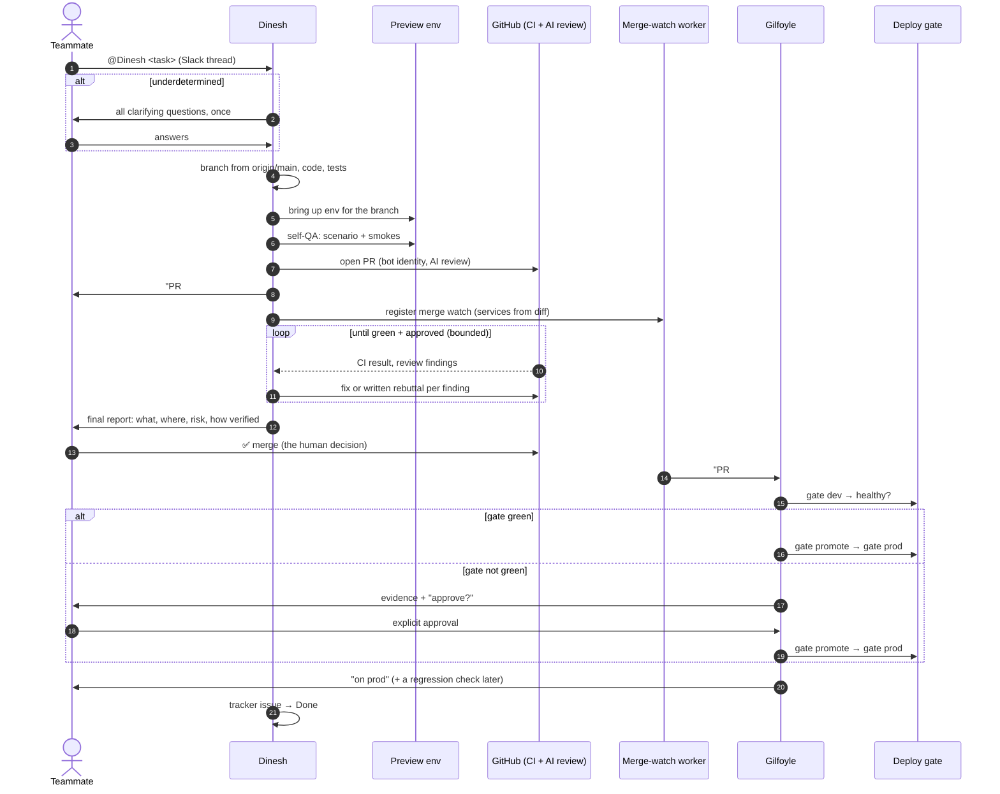
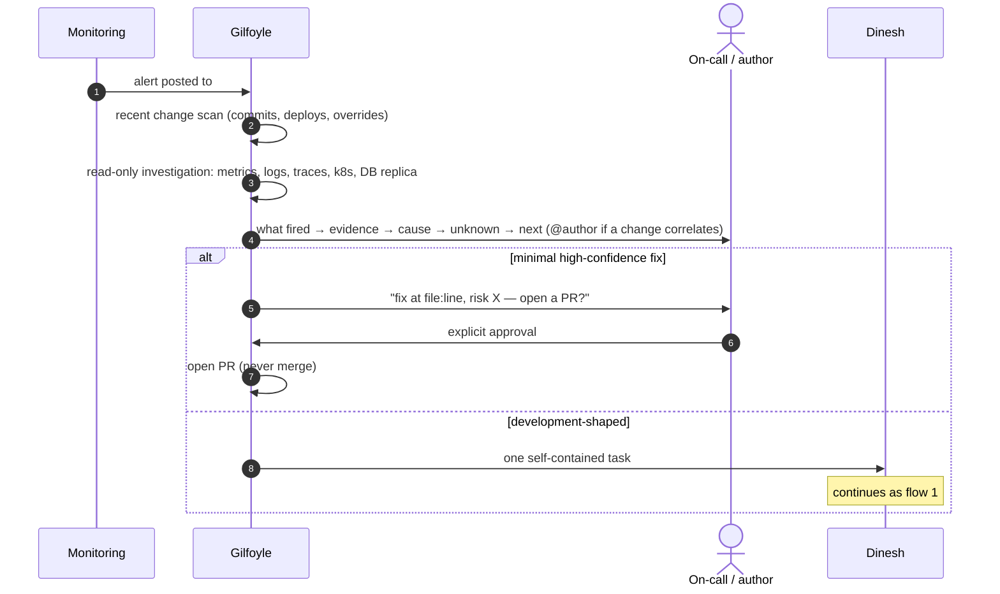
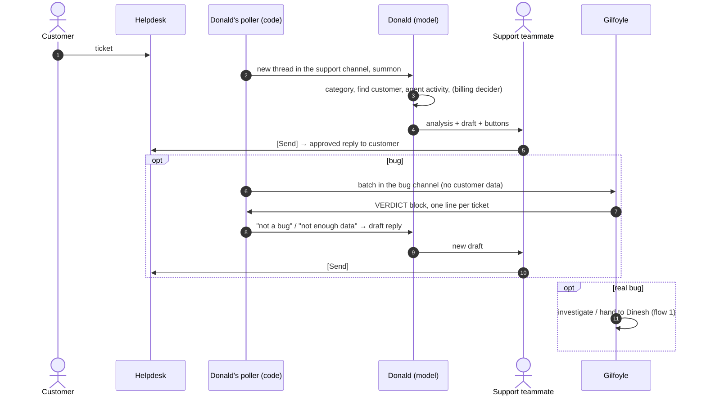
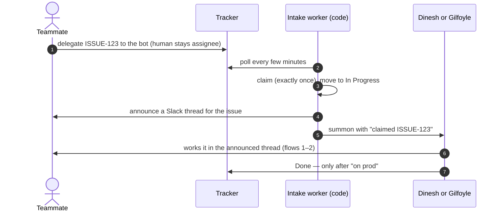

# Flows

Four flows cover almost everything the agents do. In each one, look for where the human is — and how
few places that is.

## 1. Feature or bugfix: task → prod

**Human touchpoints:** the task, answers if asked, the merge, an approval only if the gate is red.

## 2. Incident: alert → verdict (→ fix)

**Human touchpoints:** grading the impact, approving Gilfoyle's PR, merging.

## 3. Support ticket → bug → verdict → reply

**Human touchpoints:** every free-form word that reaches the customer; every money action not yet
switched on.

## 4. Delegated issue in the tracker

The worker owns the mechanics — announce, claim, status move — so the model never re-decides them and a
restart never double-claims. The model is summoned only when there is something to do.

## Message discipline across all flows

- **Short by default.** A verdict, not a diary. Long form goes in a collapsible or a file.
- **One progress message at most** (Dinesh's "PR #N — waiting"); everything else is the final report.
- **A dead turn is not a status update.** Resume and finish; never post "here's where I got to".
- **Words are for humans.** Bots don't thank, correct or lecture each other.
