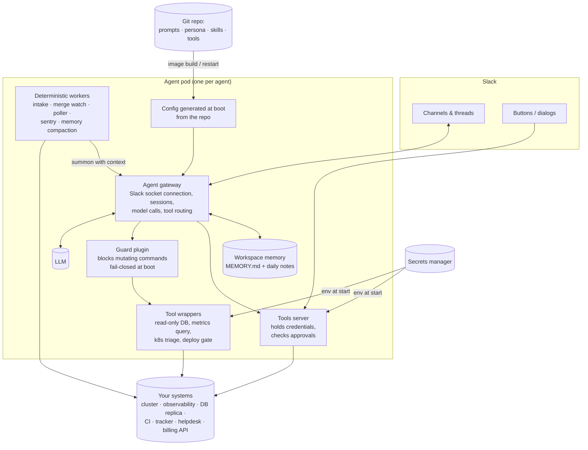

# Architecture

The generic shape of one agent. All three share it; Donald is a trimmed copy of Gilfoyle.

## Components

| Component | What it does | Notes |
|---|---|---|
| **Agent gateway** | holds the Slack connection, maps a thread to a session, calls the model, routes tools | we use an open-source agent gateway; any harness with Slack, sessions and plugins works |
| **Guard plugin** | inspects every command before it runs; refuses mutating cloud/cluster verbs | the pod refuses to start if the guard is not loaded |
| **Tool wrappers** | small CLIs that return a verdict, not a dump (a read-only DB query, a metrics query, a triage summary) | smaller output = cheaper turns and less to leak |
| **Tools server (MCP)** | the only process holding high-value credentials; validates approvals before sending or paying | the model can call it, never read its secrets |
| **Deterministic workers** | cron-like loops that poll, claim, watch and summon | each has tests; a "sentry" alerts when an enabled job hasn't run |
| **Memory** | plain files in the workspace, loaded at bootstrap under a fixed budget | see [operations](07-operations.md) |
| **Config at boot** | generated from the repo on every start | in-pod edits don't survive — on purpose |

## Deployment

- One pod per agent, its own service account, its own Slack app, its own secrets.
- Image built on merge; **merge = deploy** for the dev bot; the SRE bot never deploys itself.
- Secrets synced from a secrets manager into the pod's environment. The sync is all-or-nothing: one
  missing key stops the whole secret — create every key before the first deploy.

## The slots to fill

We don't publish our exact vendors: a public map of someone's stack is a free head start for an
attacker. What matters is the slot and what it has to give the agents.

| Slot | What the agents need from it | Fits |
|---|---|---|
| Chat | threads, mentions, one app identity per agent | Slack, Microsoft Teams, Discord, Mattermost |
| Agent harness | tools, memory, hooks to put a guard in front of every tool call | an open-source agent gateway, Claude Agent SDK, LangGraph, a custom loop |
| Models | solid tool use; a bigger model for deep dives, a faster one for busy channels | any frontier model API |
| Runtime | one isolated workload identity per agent | any container platform |
| Secrets | mounted at start, never visible to the model | a cloud secrets manager, Vault, Doppler |
| Code host | an App identity per bot, branch protection | GitHub, GitLab, Bitbucket |
| CI/CD | an API to start exactly one named job and read its result | GitHub Actions, GitLab CI, Buildkite, Argo CD and the rest |
| Observability | queryable metrics, logs and traces | any metrics + logs + traces stack |
| Tracker | webhooks, delegation to a bot user | any tracker with an API |
| Helpdesk | ticket API, internal notes | any helpdesk with an API |
| Analytics | a read-only role on de-identified events | any warehouse |

## Gotchas worth knowing

- **One Slack app, two connections = lost messages.** Slack fans events across both connections
  nondeterministically. During a migration, the one state that must never exist is both pods up with
  tokens.
- **A UI-only "pause" on a CI job is not config.** The next config-as-code import erased ours. If a
  switch matters, it lives in the repo.
- **API keys default to short expiry.** An expired admin key turned every lookup into a 401 with nothing
  else failing. Set the longest expiry and put renewal on a calendar.
- **Sandboxed code-execution bridges can't wait.** Delays inside the sandbox die; waits belong on the
  host side.
- **Tool output may pass through a redaction layer.** Parse data in the shell and return the small verdict.
