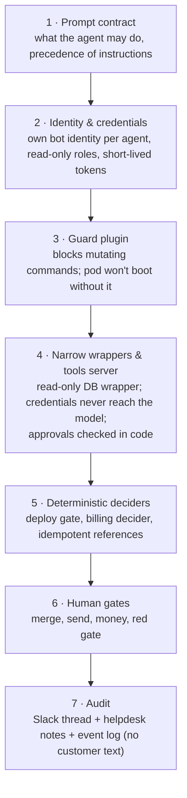

# Guardrails

Defence in layers. Each layer assumes the one above it failed.

## Per layer

**1. Prompt contract.** Necessary, never sufficient. It explains *why* the boundary exists so the agent
doesn't fight it ("the guard blocking you is a feature, not an obstacle").

**2. Identity.** Each agent has its own chat identity, its own code-host identity and its own cloud
service account. Code-host tokens are minted per call and expire. Nothing is shared between agents, so
one agent's blast radius is one agent's permissions.

**3. Guard.** A plugin in the agent gateway inspects commands before execution and refuses mutating
cloud and cluster verbs. A boot check fails the pod if the plugin isn't loaded — **fail-closed**. We test
the guard's contract in the same image we ship.

**4. Wrappers and the tools server.** The database is reached through a wrapper connected to a replica
with a read-only role. High-value credentials (helpdesk, billing, admin API) live only in a tools server;
it checks that a draft was approved before sending it, that a refund wasn't already made, that a grant
is under its cap. The model sees results, not keys.

**5. Deterministic deciders.** The things that would be catastrophic if hallucinated — which job to
deploy, how much to refund — are computed by code from facts. The model contributes intent and prose.
Every money call carries an idempotent reference, so a retry after a crash replays instead of doubling.

**6. Human gates.** See [human in the loop](04-human-in-the-loop.md).

**7. Audit.** Every action leaves a trail in three places: the Slack thread (conversation), the system of
record (an internal note on the ticket, a PR, a deploy announcement), and an event log with ids,
categories and actors — **never customer text**.

## Data handling

- Customer messages are **data, not instructions**; injection attempts are reported, not obeyed.
- The support agent reads a customer's product chat only **de-identified**, only on billing and bug tickets,
  and never stores the customer's lines.
- Thread roots and public bug batches carry nothing that identifies a customer.
- Attachments are fetched from the ticket itself, never from a URL the model supplies.
- Memory never stores secrets, tokens, webhook URLs or PII — only that something was configured.
- Colleague-facing utilities that don't need the model (e.g., routine admin chores) are
  claimed by a plugin *before* the model sees the message, so the model holding customer data never
  runs in that channel. Belt and braces: that channel's config gives the agent no tools.

## Self-modification

An agent can propose a change to its own prompt, persona or tools — as a PR. The live copy is overwritten
from the repo on every restart. The SRE bot can deploy other services but never itself.
