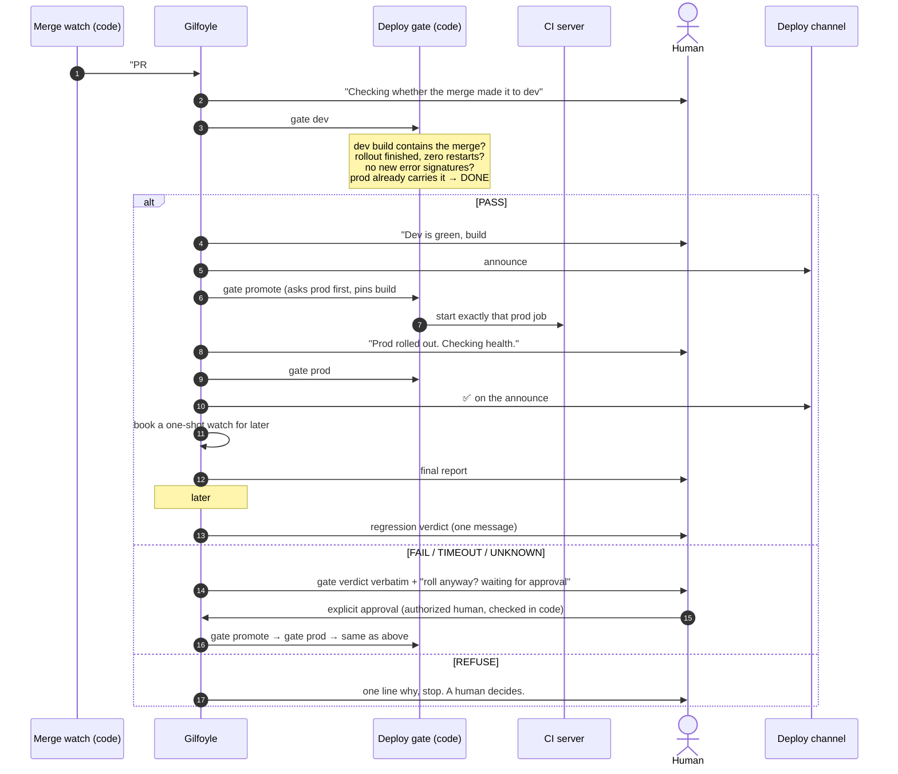

# Case: how Gilfoyle rolls to prod and watches it

The deploy is the part of the factory people are most nervous about handing to an agent, so it's the
part with the most code and the fewest decisions left to the model.

## The idea in one line

**A merged PR is the deploy request.** A human already decided to ship by pressing Merge, so nobody is
asked "shall I roll it?" again when dev is green. The question comes back only when the gate isn't sure.

## The flow

## What the gate checks (so the model doesn't have to)

| Gate | Answers PASS when |
|---|---|
| `dev` | the PR is merged and recent; a green dev build contains the merge commit; long-running workloads finished rolling out with that build and zero restarts; no new error signature appeared since the rollout |
| `promote` | prod doesn't already carry the merge; then it starts the one prod job for that service, pinned to the exact dev build the gate checked |
| `prod` | the prod rollout finished and is healthy |

A service the gate doesn't know comes back `UNSUPPORTED`: a human deploys it.

## Message discipline

One short line when a phase **starts**, nothing while it runs:

1. "Checking whether the merge made it to dev"
2. "Dev is green (build #B, no new errors). Rolling to prod." (this line *is* the go)
3. "Prod rolled out. Checking health."

Then the final report, and one regression verdict a while later. No heartbeats, no log
excerpts, no tool names. One flow per handoff, even for several services.

## Rules that came from incidents

- **Only the gate pushes the button.** A hand-typed CI run once shipped the *next* dev build instead of
  the one the gate had checked: the prod job's dependency rebuilt from a `main` that had moved. Now the
  gate prints the exact command, pinned to the checked build, and nothing else may start a prod job.
- **Ask prod before promoting.** A turn that re-entered several times once promoted the same build six
  times in a row. The promote now asks prod what it already carries and answers DONE.
- **Never himself.** Gilfoyle can roll any service except his own. A self-deploy kills the pod mid-run
  and the deploy finishes unattended. That one stays human-triggered.
- **No heroic rollbacks.** A failed promote is reported, not retried. Rolling back is a human's call.
- **A reaction is not a yes.** Approval is an explicit message from an authorized human, checked in
  code, not by the model. An emoji is not an approval. Ambiguous means no.
- **Read the diff before judging the change.** When a verdict depends on what the change *means*, the
  code goes first, then one question to the author bot. Judging semantics from logs alone produced a
  confidently wrong verdict once.
- **Don't supervise the developer.** After the merge, Dinesh goes silent; two bots checking one rollout is
  noise. He answers implementation questions about his diff, once.

## Watching prod between deploys

The same agent is the one reading the alert channel, so the deploy history is part of every
investigation: the first step of any alert is a scan of recent change (commits, deploys,
config overrides), and a correlating change gets its author mentioned with an argument from the diff's
mechanism, not from timing. See [Gilfoyle](../characters/gilfoyle.md) and the
[incident flow](03-flows.md#2-incident-alert--verdict--fix).

## Build your own

The pattern ports to any CI/CD: GitHub Actions environments with required reviewers for the red path,
Argo CD or Flux for the promote, your observability stack's error-signature diff for the dev gate. The
non-negotiable parts are that **the gate is code**, **the trigger is pinned to what was checked**, and
**the agent can't deploy itself**.
